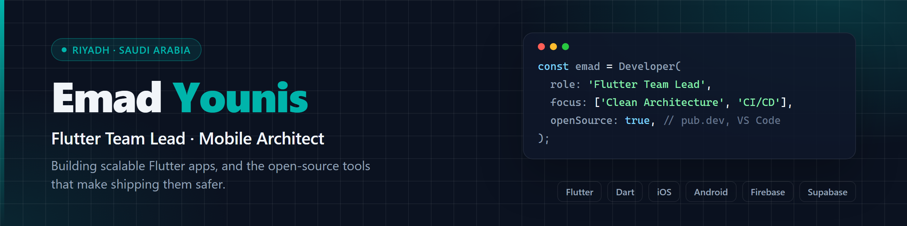

<picture>
  <source media="(prefers-color-scheme: dark)" srcset="assets/header-dark.png">
  <source media="(prefers-color-scheme: light)" srcset="assets/header-light.png">
  
</picture>

 

 

 

## About

I'm a **Flutter Team Lead** based in Riyadh with 8 years in IT, the last 3 focused on cross-platform mobile architecture. I own the full lifecycle of an app, from the first architecture decision to automated store releases, and I like turning the repetitive, error-prone parts of that work into tools the whole Flutter community can use.

| | |
| --- | --- |
| **Architecture** | Clean Architecture, BLoC, Flutter Flavors and modular design for enterprise-scale apps |
| **Delivery** | CI/CD pipelines with automated distribution through TestFlight and Google Play |
| **Leadership** | Mentoring developers, technical delegation and delivery of complex products such as marketplaces and real-time tracking platforms |
| **Now** | Leading the mobile team at **Minjabl Technology** and maintaining open-source Flutter tooling |

 

## Open source

<table>
  <tr>
    <td width="50%" valign="top">
      <h3>🔐 <a href="https://github.com/Emad-Pro/ios_privacy_localizer">ios_privacy_localizer</a></h3>
      
      
      
      
Localizes iOS permission prompts (<code>NS*UsageDescription</code>) in every language from a single YAML block. Updates <code>Info.plist</code>, <code>InfoPlist.strings</code> and <code>project.pbxproj</code> with atomic writes, backups, post-write validation and automatic rollback. Ships a <code>--validate</code> mode for CI.

      
<a href="https://pub.dev/packages/ios_privacy_localizer">pub.dev</a> · <a href="https://github.com/Emad-Pro/ios_privacy_localizer">Source</a>

    </td>
    <td width="50%" valign="top">
      <h3>🌍 <a href="https://github.com/Emad-Pro/app_name_localizer">app_name_localizer</a></h3>
      
      
      
A CLI that localizes and manages the app display name on iOS and Android straight from the terminal. Designed for CI/CD pipelines and built to work side by side with <code>ios_privacy_localizer</code>.

      
<a href="https://pub.dev/packages/app_name_localizer">pub.dev</a> · <a href="https://github.com/Emad-Pro/app_name_localizer">Source</a>

    </td>
  </tr>
  <tr>
    <td colspan="2" valign="top">
      <h3>🧩 <a href="https://marketplace.visualstudio.com/items?itemName=flutter-clean-architecture.flutter-easy-arch">Flutter EA Toolkit</a> VS Code extension</h3>
      
      
      
Generates Clean Architecture, MVVM, MVC and MVP boilerplate for Flutter with Bloc, Riverpod, GetX or Provider. Every generated feature comes with dependency injection wired up, a TDD-ready folder structure and smart Dart snippets.

      
<a href="https://marketplace.visualstudio.com/items?itemName=flutter-clean-architecture.flutter-easy-arch">Marketplace</a> · <a href="https://github.com/Emad-Pro/flutter-clean-architecture">Source</a>

    </td>
  </tr>
</table>

 

## Tech stack

  

 

| Area | What I work with |
| --- | --- |
| **Mobile** | Flutter, Dart, native iOS and Android integration, Flutter Flavors, platform channels |
| **State & architecture** | Clean Architecture, BLoC, Riverpod, Provider, GetX, dependency injection, TDD |
| **Backend & data** | Firebase, Supabase, REST APIs, SQLite, offline-first sync |
| **Delivery** | CI/CD, GitHub Actions, TestFlight, Google Play Console, automated versioning and store distribution |
| **Tooling** | Dart CLIs, VS Code extensions (TypeScript), code generation |

 

## GitHub activity

  
  

 

## Let's connect

I'm open to collaboration on Flutter tooling, mobile architecture and open-source packages.

- 💼 LinkedIn: [linkedin.com/in/emadpro](https://linkedin.com/in/emadpro)
- ✉️ Email: [emadeadev@gmail.com](mailto:emadeadev@gmail.com)
- 📦 pub.dev: [ios_privacy_localizer](https://pub.dev/packages/ios_privacy_localizer) · [app_name_localizer](https://pub.dev/packages/app_name_localizer)

 

  Designed and maintained by Emad Younis · Riyadh, Saudi Arabia

